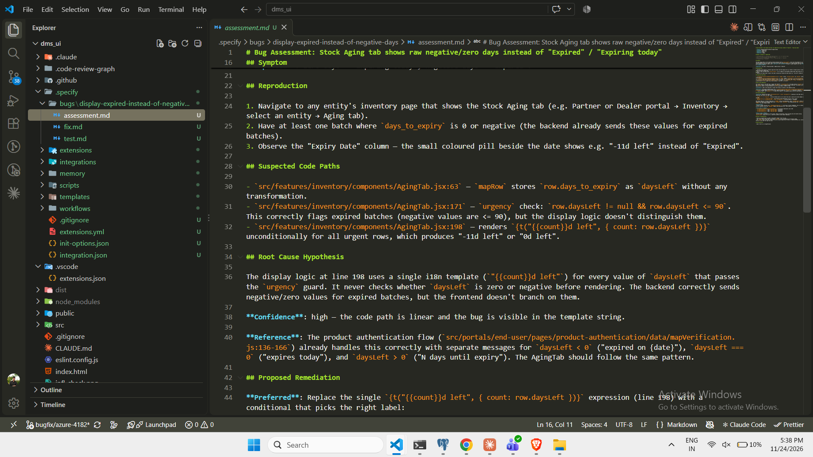
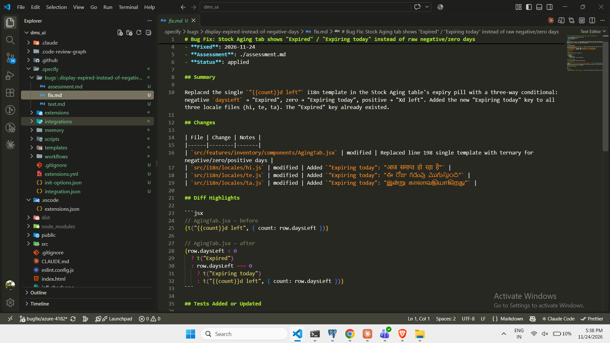
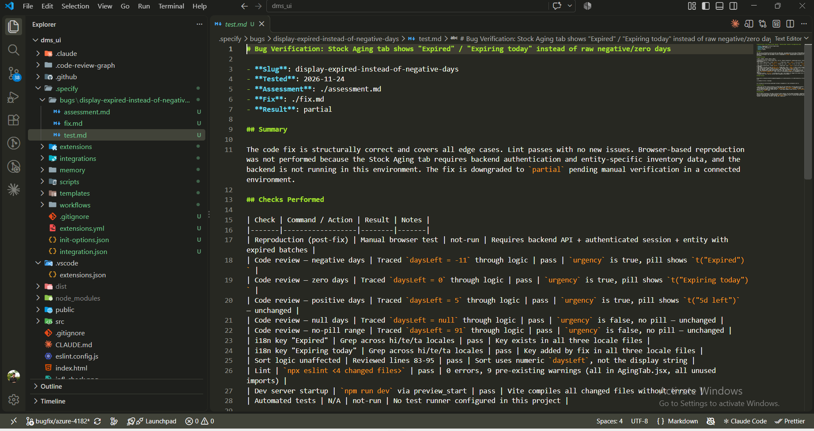

# Spec Kit Bug Fix Guide (Windows 11 + Claude Desktop)

Nov 24, 2026 · @Soumyajit

## 1. Quick check before you start

Make sure these are done. If you followed the setup guide, they already are.

| Check | How to tell |
| --- | --- |
| Spec Kit installed | `specify version` shows a number |
| Project set up | `.specify/` folder exists |
| Bug add-on installed | `specify extension list` shows `bug` |
| Rules written | `.specify/memory/constitution.md` exists |
| Claude is in Code tab | Type `/` and you see `/speckit-bug-assess` |

Missing the bug add-on? Run `specify extension add bug` in Git Bash.

Missing the rules? Type `/speckit-constitution (your rules)` in Claude's chat.

Before you fix your first bug, make sure these things are done. If you followed the earlier setup guide, they already are.

| Check | How to verify | Done? |
| --- | --- | --- |
| `specify-cli` is installed | Run `specify version` in Git Bash |  |
| Spec Kit is initialized in the project | The folder `.specify/` exists in your project |  |
| The `bug` extension is installed | Run `specify extension list` and see `bug` |  |
| Constitution is written | The file `.specify/memory/constitution.md` exists |  |
| You're in Claude Desktop's **Code** tab | You can see your project files in the sidebar |  |
| The project folder is open in Claude | Type `/` and you see `/speckit-bug-assess` in the list |  |

If the bug extension is missing, run this in Git Bash inside your project:

```bash
specify extension add bug
```

If the constitution is missing, type this in Claude's chat first:

## 2. How to fix a bug

Every bug fix is the same three steps. Like a doctor visit: check what's wrong → give medicine → see if you're better.

### Step 1: ASSESS — find the cause

Tell Claude what the bug looks like. Give it a short name (called a `slug`).

```text
/speckit-bug-assess "Describe the bug here" slug=short-name
```

Example:

```text
/speckit-bug-assess "Upload bar stuck at 90%, file never shows up" slug=upload-stuck-90
```

Claude reads your code, finds the cause, and writes a report at `.specify/bugs/upload-stuck-90/assessment.md`. It does **not** change any code.

Read the report. Makes sense? Move on. Wrong? Tell Claude and run assess again.

### Step 2: FIX — change the code

```text
/speckit-bug-fix slug=upload-stuck-90
```

Claude reads the assessment, then changes the code to fix the bug. It writes a report at `.specify/bugs/upload-stuck-90/fix.md`.

**This is the only step that touches your code.** The other two only read.

Read the fix report. Check the changed files. Use `git diff` to see every change.

### Step 3: TEST — check if it worked

```text
/speckit-bug-test slug=upload-stuck-90
```

Claude tests the fix and gives you one of three answers: **verified**, **partial**, or **failed**.

Every bug fix follows the same three steps: **assess → fix → test**. Think of it like going to the doctor: first the doctor examines you (assess), then gives medicine (fix), then checks if you're better (test).

### Step 1: ASSESS — find the cause

Tell Claude what the bug looks like. Use a `slug` (a short nickname with dashes, no spaces) to name this bug.

```text
/speckit-bug-assess "Describe what goes wrong here" slug=short-name-for-bug
```

**Real example for dms\_ui:**

```text
/speckit-bug-assess "When a user uploads a document, the progress bar gets stuck at 90% and the file never appears in the document list even though it was saved to the server" slug=upload-stuck-90
```

What Claude does:

- Reads your code to find where the bug lives
- Figures out the root cause
- Writes a report at `.specify/bugs/upload-stuck-90/assessment.md`

What Claude does NOT do:

- It does **not** change any code
- It only reads and thinks

**What to do next:** Read the assessment. Does Claude's explanation make sense? Does it point to the right files? If yes, move on. If not, tell Claude what it got wrong and run assess again.

### Step 2: FIX — apply the cure

```text
/speckit-bug-fix slug=upload-stuck-90
```

What Claude does:

- Reads the assessment report it wrote in step 1
- Changes the actual code files to fix the bug
- Writes a report at `.specify/bugs/upload-stuck-90/fix.md` explaining what it changed and why

**This is the only step that touches your code.** Assess and test never change code files.

**What to do next:** Read the fix report. Open the changed files and look at the actual changes. Do they make sense? If you use Git, run `git diff` to see every line that changed.

### Step 3: TEST — prove it works

```text
/speckit-bug-test slug=upload-stuck-90
```

What Claude does:

- Runs the original bug scenario again
- Runs any tests it wrote during the fix
- Writes a report at `.specify/bugs/upload-stuck-90/test.md`
- Gives a verdict: **verified**, **partial**, or **failed**

## 3. What the results mean

| Result | Meaning | Do this |
| --- | --- | --- |
| **verified** | Bug is gone. Tests pass. | Done! Commit and push. |
| **partial** | Partly fixed. Something still wrong. | Run fix → test again. |
| **failed** | Fix didn't work. | Give more details, run fix → test again. |

Keep doing fix → test until you get **verified**.

Failed 3 times? The bug description is probably too short. Re-run assess with more detail — exact error messages, which browser, what file type.

```text
/speckit-bug-assess "Upload stuck at 90% — only with PDFs over 5MB. Console shows timeout after 30s." slug=upload-stuck-90
```

More detail = better fix.

The test step gives one of three verdicts. Here's what each means and what to do:

| Verdict | What it means | What to do |
| --- | --- | --- |
| **verified** | The bug is gone. Tests pass. The fix works. | You're done! Commit and push. |
| **partial** | The bug is partly fixed but something is still wrong. | Read the test report to see what failed. Run `/speckit-bug-fix slug=your-slug` again, then `/speckit-bug-test slug=your-slug` again. |
| **failed** | The fix didn't work. The bug is still there. | Read the test report carefully. Tell Claude what you see. Run `/speckit-bug-fix slug=your-slug` again with more details about what went wrong. |

**The loop for partial or failed:**

```text
/speckit-bug-fix slug=upload-stuck-90      ← try fixing again
/speckit-bug-test slug=upload-stuck-90     ← test again
```

Keep repeating fix → test until you get **verified**. If it fails 3 times, something bigger may be wrong. Consider re-running assess with more details about the bug:

```text
/speckit-bug-assess "Same upload bug but I noticed it only happens with PDF files larger than 5MB. The console shows a timeout error after 30 seconds." slug=upload-stuck-90
```

## 4. What folders get made

Bug reports go in `.specify/bugs/`, separate from your code.

```text
your-project/
├── .specify/
│   ├── bugs/
│   │   ├── upload-stuck-90/       ← one folder per bug
│   │   │   ├── assessment.md      ← what caused it
│   │   │   ├── fix.md             ← what was changed
│   │   │   └── test.md            ← proof it works
│   │   └── login-error/           ← another bug
│   └── memory/
│       └── constitution.md        ← your rules
├── .claude/skills/                ← the commands
├── specs/                         ← feature specs (not bugs)
└── src/                           ← your code (fix goes here)
```

Each bug gets its own folder named after its slug. Months later you can still see what every bug was and how it was fixed.

After fixing the "upload-stuck-90" bug, your project looks like this. Bug reports live inside `.specify/bugs/`, completely separate from your code and your feature specs.

```text
dms_ui/
├── .claude/
│   └── skills/
│       ├── debug-issue/              ← your old skills (untouched)
│       ├── explore-codebase/
│       ├── refactor-safely/
│       ├── review-changes/
│       ├── speckit-bug-assess/       ← bug extension commands
│       ├── speckit-bug-fix/
│       ├── speckit-bug-test/
│       ├── speckit-constitution/      ← core Spec Kit commands
│       ├── speckit-specify/
│       └── ... (other speckit commands)
├── .specify/
│   ├── bugs/
│   │   ├── upload-stuck-90/          ← one folder per bug
│   │   │   ├── assessment.md         ← what caused it (step 1)
│   │   │   ├── fix.md                ← what was changed (step 2)
│   │   │   └── test.md               ← proof it works (step 3)
│   │   └── login-error/              ← another bug you fixed
│   │       ├── assessment.md
│   │       ├── fix.md
│   │       └── test.md
│   ├── memory/
│   │   └── constitution.md           ← your project rules
│   ├── scripts/
│   ├── templates/
│   └── feature.json
├── specs/                             ← feature specs (separate from bugs)
└── src/                               ← your actual code (fix applied here)
```








## 5. Git — what to push, what to skip

### Push these

| What | Why |
| --- | --- |
| `.specify/bugs/` | Bug history — your team learns from it |
| `.specify/memory/constitution.md` | Rules — everyone follows them |
| `.specify/templates/` and `.specify/scripts/` | Shared setup files |
| `.claude/skills/speckit-*/` | Commands for Claude |
| `specs/` | Feature plans |
| Your code changes | The actual fix |

### Skip these

| What | Why |
| --- | --- |
| `.specify/feature.json` | Per-person. Already in Spec Kit's `.gitignore`. |
| `.claude/settings.local.json` | Your personal settings |
| `.claude/settings.json.bak` | Backup file |

Add to your `.gitignore`:

```gitignore
.claude/settings.local.json
.claude/settings.json.bak
```

### After a verified fix

```bash
git add .
git commit -m "fix: upload stuck at 90% (speckit verified, slug=upload-stuck-90)"
git push
```

### Files to PUSH to GitHub

These files help your team and serve as a history of your work:

| File / Folder | Why push it |
| --- | --- |
| `.specify/bugs/*/assessment.md` | Documents what caused each bug — your team learns from it |
| `.specify/bugs/*/fix.md` | Documents what was changed — future devs understand why |
| `.specify/bugs/*/test.md` | Proof the fix works — builds confidence in the fix |
| `.specify/memory/constitution.md` | Project rules — everyone follows the same rules |
| `.specify/templates/` | Blank forms Spec Kit uses — keeps things consistent |
| `.specify/scripts/` | Helper scripts — same for everyone |
| `.specify/extensions.yml` | Which extensions are installed — teammates get the same setup |
| `.claude/skills/speckit-*/` | The slash commands — so Claude works for teammates too |
| `specs/` (if you have feature specs) | Your feature specs, plans, and tasks |
| Your actual code changes | The fix itself |

### Files to SKIP (do not push)

| File | Why skip it |
| --- | --- |
| `.specify/feature.json` | Tracks which feature *you* are on right now — different per developer. Already excluded by Spec Kit's own `.gitignore`. |
| `.specify/extensions/*/local-config.yml` | Your personal extension settings. Already excluded. |
| `.claude/settings.local.json` | Your personal Claude settings |
| `.claude/settings.json.bak` | A backup file |

### Add this to your project's root `.gitignore`

```gitignore
# Claude personal files
.claude/settings.local.json
.claude/settings.json.bak
```

The `.specify/` folder already has its own `.gitignore` that handles `feature.json` and `local-config.yml` — you don't need to add those.

### Commit message convention

Use clear commit messages that mention the bug slug:

```bash
# After a verified bug fix
git add .
git commit -m "fix: resolve upload stuck at 90% (speckit verified, slug=upload-stuck-90)"
git push

# If you also want to push the Spec Kit setup (first time only)
git add .specify/ .claude/ specs/
git commit -m "chore: add Spec Kit setup with bug extension"
git push
```

## 6. Fixing more than one bug

Each bug gets its own slug. They don't mix.

**Fix one at a time.** Finish one, commit it, then start the next.

```text
/speckit-bug-assess "Upload stuck" slug=upload-stuck
/speckit-bug-fix slug=upload-stuck
/speckit-bug-test slug=upload-stuck       ← get "verified"
git add . && git commit -m "fix: upload-stuck"

/speckit-bug-assess "Login blank on mobile" slug=mobile-login
/speckit-bug-fix slug=mobile-login
/speckit-bug-test slug=mobile-login        ← get "verified"
git add . && git commit -m "fix: mobile-login"
```

Why one at a time? Because one fix might change files another fix also needs. Doing them together can cause new bugs.

**Slug tips:** lowercase, dashes, short but clear. `upload-stuck` is better than `bug-3`.

Each bug gets its own slug, so you can track many bugs at the same time. They don't interfere with each other.

**Example: fixing three bugs in `dms_ui`**

```text
/speckit-bug-assess "Upload progress bar stuck at 90%" slug=upload-stuck-90
/speckit-bug-assess "Login page shows blank screen on mobile" slug=mobile-login-blank
/speckit-bug-assess "Search results don't update when filter changes" slug=search-filter-stale
```

Each one creates its own folder:

```text
.specify/bugs/
├── upload-stuck-90/
├── mobile-login-blank/
├── search-filter-stale/
```

**Best practice: fix one bug completely before starting the next.** The full flow for each:

```text
/speckit-bug-assess "..." slug=bug-one
/speckit-bug-fix slug=bug-one
/speckit-bug-test slug=bug-one          ← get "verified"
git add . && git commit -m "fix: bug-one (verified)"

/speckit-bug-assess "..." slug=bug-two
/speckit-bug-fix slug=bug-two
/speckit-bug-test slug=bug-two          ← get "verified"
git add . && git commit -m "fix: bug-two (verified)"
```

Why one at a time? Because one bug's fix might change files that another bug also touches. If you fix them together, the second fix might break the first one. Doing them one at a time with a Git commit after each means you can always go back.

**Slug naming tips:**

## 7. Using code-review-graph with bug fixes

If you have code-review-graph, you can use it alongside Spec Kit for extra safety.

**Before fixing** — see what might break:

```text
Use code-review-graph to show the impact radius of the files in .specify/bugs/upload-stuck/assessment.md
```

**After fixing** — check the risky parts:

```text
Use code-review-graph to detect changes and show the most risky parts of this bug fix.
```

You don't have to do both. Just the "before fixing" check alone catches most surprises.

If you have code-review-graph installed (like in `dms_backend`), you can combine it with the bug fix flow for extra safety.

**Before the fix — understand what you're touching:**

```text
(after /speckit-bug-assess, before /speckit-bug-fix)

Use code-review-graph to show the impact radius of the files mentioned in .specify/bugs/upload-stuck-90/assessment.md. What else could break if we change those files?
```

This tells you which other parts of the app might be affected by the fix, so you can watch for side effects.

**After the fix — review the changes:**

```text
(after /speckit-bug-fix, before /speckit-bug-test)

Use code-review-graph to detect changes and show me the most risky parts of this bug fix.
```

This shows you which changes are most likely to cause new problems, so you know where to look carefully.

**After verified — check code health:**

```text
(after /speckit-bug-test says "verified")

Use code-review-graph to update the graph and check if the fixed files have any large functions or code smells that we should clean up.
```

## 8. Common problems

| Problem | Fix |
| --- | --- |
| `/speckit-bug-assess` doesn't show up | Open Claude Desktop → **Code** tab → open your project folder. Check `.claude/skills/speckit-bug-assess/` exists. If not: `specify extension add bug` |
| `specify: command not found` | Close terminal, reopen. Still broken? `pip install specify-cli` |
| `No .specify/extensions.yml found` | Just a notice, not an error. Everything works. |
| "Ensure scripts executable" not ticked | Windows thing. Ignore it. |
| Claude can't find the assessment | Use the **same slug** in all 3 steps. |
| Fix broke something else | `git checkout .` to undo. That's why you commit after each verified fix. |
| Failed 3 times | Bug description too short. Re-run assess with more detail. |

## 9. Cheat sheet

### Setup (once per project)

```bash
specify extension add bug                    # add bug fixing
/speckit-constitution (your rules)           # in Claude chat
```

### Every bug

| Step | Command | Touches code? |
| --- | --- | --- |
| 1. Assess | `/speckit-bug-assess "description" slug=name` | No |
| 2. Fix | `/speckit-bug-fix slug=name` | **Yes** |
| 3. Test | `/speckit-bug-test slug=name` | No |

### After verified

```bash
git add .
git commit -m "fix: short description (slug=name)"
git push
```

### Rules to remember

- Same slug in all 3 steps
- Read every report before the next step
- One bug at a time — fix, verify, commit, then next
- More detail in the description = better fix
- Only fix touches your code — assess and test just read

### One-time setup (per project)

| Step | Command | Where |
| --- | --- | --- |
| Install Spec Kit | `pip install specify-cli` | Git Bash (once ever) |
| Init in project | `specify init --here --force --integration claude` | Git Bash, in project folder |
| Add bug extension | `specify extension add bug` | Git Bash, in project folder |
| Write constitution | `/speckit-constitution (your rules)` | Claude chat |

### Every bug fix

| Step | Command | What it does | Touches code? |
| --- | --- | --- | --- |
| 1. Assess | `/speckit-bug-assess "description" slug=name` | Finds the root cause | No |
| 2. Fix | `/speckit-bug-fix slug=name` | Applies the code fix | **Yes** |
| 3. Test | `/speckit-bug-test slug=name` | Proves the fix works | No |

### After "verified"

```bash
git add .
git commit -m "fix: short description (speckit verified, slug=name)"
git push
```

### Quick rules

- **Same slug** in all three steps — always
- **Read every report** before moving to the next step — always
- **One bug at a time** — fix it, verify it, commit it, then start the next
- **More detail = better fix** — include error messages, steps to reproduce, which browser/device
- Only `/speckit-bug-fix` changes your code — assess and test just read and report
